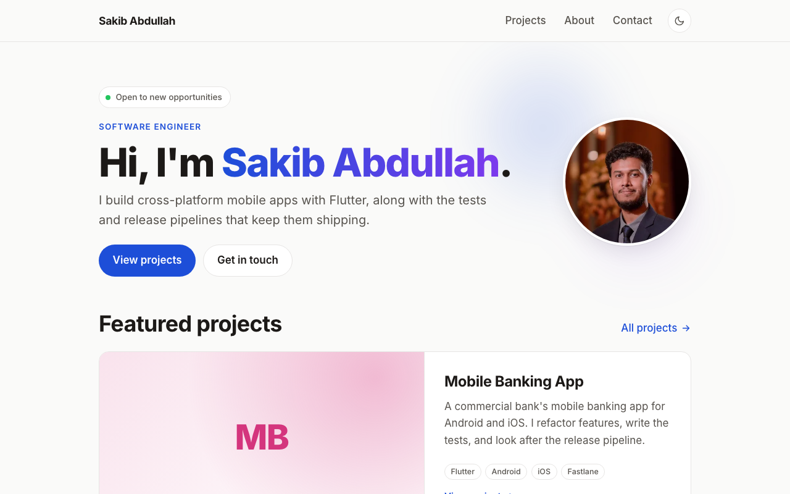

# Portfolio

Source for my personal site: a short intro, a few project write-ups, an about page and a way to
get in touch. It is static HTML and CSS with a small amount of JavaScript for the theme toggle and
scroll animations, which keeps it fast and cheap to host.



## Stack

- [Astro](https://astro.build) 7 with static output and no UI framework
- Plain CSS. Colours are declared once with `light-dark()`, so each token carries its light and dark value
- [Inter](https://rsms.me/inter/) through Fontsource, served from the site itself rather than Google
- Project pages generated from Markdown files in a content collection, validated at build time
- Hosted on Cloudflare Pages

## Running it locally

You need Node 22.23 or newer (the exact version is pinned in `.node-version`) and npm.

```sh
git clone https://github.com/SakibAbdullah75/portfolio.git
cd portfolio
npm install
npm run dev
```

The dev server runs at http://localhost:4321 and reloads on save.

| Script            | What it does                                         |
| ----------------- | ---------------------------------------------------- |
| `npm run dev`     | Start the dev server                                 |
| `npm run build`   | Build the site into `dist/`                          |
| `npm run preview` | Serve `dist/` locally to check a build               |
| `npm run check`   | Type-check `.astro` and `.ts` files                  |
| `npm run deploy`  | Build and upload to Cloudflare Pages (see Deploying) |

## Layout of the repo

```
src/
  assets/            avatar and project screenshots, optimised at build time
  components/        Header, Footer, ProjectCard
  content/projects/  one Markdown file per project
  content.config.ts  schema for the projects collection
  data/site.ts       name, role, bio, skills, experience, links, contact details
  layouts/           BaseLayout: <head>, fonts, theme script, scroll-reveal script
  pages/             file-based routes
  styles/global.css  all styling, including print rules
public/              favicon and robots.txt
docs/                screenshot used in this README
```

Routes map to files in `src/pages/`: `index.astro` is `/`, `about.astro` is `/about`, and
`projects/[slug].astro` produces one page per project.

## Editing content

Most of the text on the site comes from `src/data/site.ts`. Skills, experience, education, social
links, the availability badge and the contact panel are plain arrays and strings in that file.
Anything left empty is not rendered, so the site never shows template text. Search the repo for
`TODO` to find what is still missing.

### Projects

Add a Markdown file to `src/content/projects/`. The file name becomes the URL.

```md
---
title: "Example App"
description: "One line for the card."
date: 2026-05-01                                         # start, or the only date
endDate: 2026-08-01                                      # optional; or ongoing: true
client: "Example Ltd"                                    # optional
tags: ["Flutter", "Android"]
repo: "https://github.com/SakibAbdullah75/example-app"   # optional
live: "https://example.app"                              # optional
featured: true                                           # optional, shows on the home page
cover: "../../assets/projects/example-app.png"           # optional
coverAlt: "Dashboard view of Example App"                # optional
---

Write-up in Markdown.
```

Covers work best at 16:10, 1280×800 or larger. Cards crop to that ratio and the project page shows
the full image. Astro resizes and converts them to WebP during the build, so commit the original.

The projects in there now are client work from my jobs, described generically on purpose: no real
product or client names. The build guard refuses to publish any name listed in a `.confidential`
file at the repo root (one per line, git-ignored), so a slip cannot go live. Most projects have no
screenshot yet, so their cards show a tinted tile with the project's initials until one is added. Ongoing work sorts first, then
everything else by its end date.

### Photo

`src/assets/avatar.jpg` is a square head-and-shoulders crop, shown as a circle on the home and
About pages. Keep it square and at least 640px; Astro resizes and converts it at build time. If the
format is different, update the import at the top of `site.ts`. The original photo stays out of git
(root-level image files are ignored).

### Contact form

The contact page works without a form: email with a copy button, plus social links. To turn the
form on, create a free key at [web3forms.com](https://web3forms.com) and put it in
`contact.formAccessKey` in `site.ts`. Submissions go straight to the inbox; there is no server to run.

## Design notes

**Theme.** A small inline script in `BaseLayout.astro` reads `localStorage` before first paint and
sets `data-theme` on `<html>`, so there is no flash of the wrong theme. Without a saved choice it
follows the system setting.

**Motion.** Hero elements stagger in on load, sections fade up on scroll using an
`IntersectionObserver`, and navigation uses native cross-document view transitions, so a project
thumbnail morphs into the cover image. All of it is disabled under `prefers-reduced-motion`. The
print stylesheet forces every section visible, so saving a page as PDF never leaves blank spots.

**Fonts.** To swap Inter, install another Fontsource package, change the import in
`BaseLayout.astro` and update `--font-sans` in `global.css`. Removing the import falls back to the
system font.

## Deploying

The build is static files, so it can be hosted anywhere. It is set up for Cloudflare Pages.

**Build on push.** Connect the repo in the Cloudflare dashboard under Workers & Pages → Create →
Pages → Connect to Git, with these settings:

| Setting                | Value           |
| ---------------------- | --------------- |
| Framework preset       | Astro           |
| Build command          | `npm run build` |
| Build output directory | `dist`          |

Every push to `main` then deploys. Cloudflare reads `.node-version` for the Node version. If a
build ever fails with an "unsupported Node.js" error, raise the number in that file to match the
`engines` field in `package.json`.

**Deploy from a machine.** Log in once with `npx wrangler login`, then `npm run deploy` builds and
uploads `dist/` to the `sakibabdullah` Pages project.

Either way the site is served from `https://<project>.pages.dev`. A custom domain can be added
under Custom domains in the Pages project; Cloudflare issues the certificate. `site` in
`astro.config.mjs` is already set to the Pages address and should be updated if the site moves.

`npm run deploy` refuses to publish if the build still contains placeholder text such as
`example.com` or "Your job title" (see `scripts/check-placeholders.mjs`).

## Still to do

- [ ] Screenshots for the client projects
- [ ] Résumé download
- [ ] Open Graph image for link previews
